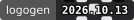

# logogen

> Deterministic SVG logo & GitHub badge generator — zero dependencies.

Generates consistent, beautiful logos from a **name + version + palette + pattern**.
The same inputs always produce the same logo: `name → letters`, `coarse version → layout`, `full version → fine details`.



---

## ✨ Features

- **Zero dependencies** — pure Node.js, no npm install needed
- **Deterministic** — identical inputs → identical output
- **Version-aware** — supports SemVer, CalVer, and git hashes
- **10 patterns** — `bands`, `orbs`, `rings`, `tiles`, `sunburst`, `checker`, `waves`, `nested`, `blobs`, `mirror`, `aurora`
- **Shapes** — `squircle` (default), `circle`, `square`
- **Fonts** — `sans`, `mono`
- **Badge mode** — flat/flat-square shields.io-style badges
- **Interactive TUI** — browse all palettes and patterns interactively

---

## 🚀 Quick Start

```bash
# Logo (deterministic, no install required)
node cli/logogen.mjs --name "My Tool" --version 1.2.3 \
     --palette "#09090b,#27272a,#52525b,#a1a1aa,#e4e4e7" --out logo.svg

# Badge
node cli/logogen.mjs --badge --name "My Tool" --version 1.2.3 --out badge.svg

# Interactive TUI (browse all palettes & patterns)
node cli/logogen-tui.mjs
```

Register with [cmdreg](../cmdreg) to use as `logogen` system-wide.

---

## 📐 CLI Options

```
node cli/logogen.mjs --name "Product" [OPTIONS]

Options:
  --name <text>           Tool / product name (required)
  --version <ver>         SemVer, CalVer or git hash (default: 0.0.0)
  --palette <colors>      Comma-separated hex colors OR preset name
  --pattern <name>        classic | extra | all | <layout>
                          Layouts: bands, orbs, rings, tiles,
                                   sunburst, checker, waves, nested,
                                   blobs, mirror, aurora
  --shape <s>             squircle | circle | square  (default: squircle)
  --font <f>              sans | mono  (default: sans)
  --letters <n>           auto | 1 | 2 | 3 | full  (default: auto)
  --no-outline            Disable outline ring
  --size <px>             Canvas size in pixels (default: 256)
  --out <file>            Output file (default: stdout)
  --badge                 Generate badge instead of logo
  --badge-style <s>       flat | flat-square  (default: flat)
  --label <text>          Custom badge left-side label
  --label-color <hex>     Badge left-side background color
```

### Built-in palette presets

| Preset | Preview |
|---|---|
| `azure` | `#171c27 #52708b #508aaa #6ab0a3 #add3cc` |
| `azure-warm` | `#293348 #52708b #6ab0a3 #94b8cc #f7b83d` |
| `catppuccin-mocha` | `#1e1e2e #cba6f7 #f38ba8 #fab387 #89b4fa` |
| `tokyo-night` | `#1a1b26 #7aa2f7 #bb9af7 #f7768e #e0af68` |
| `dracula` | `#282a36 #bd93f9 #ff79c6 #ffb86c #50fa7b` |
| `nord` | `#2e3440 #5e81ac #88c0d0 #a3be8c #ebcb8b` |
| `rose-pine` | `#191724 #c4a7e7 #eb6f92 #f6c177 #9ccfd8` |
| `gruvbox-dark` | `#282828 #fb4934 #fabd2f #8ec07c #83a598` |
| `sunset` | `#264653 #2a9d8f #e9c46a #f4a261 #e76f51` |
| `zinc-dark` | `#09090b #27272a #52525b #a1a1aa #e4e4e7` |

---

## 📁 Structure

```
logogen/
├── cli/
│   ├── logogen.mjs       # Core generator (importable as ES module)
│   └── logogen-tui.mjs   # Interactive TUI (browse logos in terminal)
├── tools/
│   ├── generate_logo.mjs # Generate public/logo.svg + badge.svg from version.json
│   └── bump.mjs          # Bump CalVer, regenerate assets, commit
├── public/
│   ├── logo.svg          # Generated logo
│   └── badge.svg         # Generated badge
├── Makefile
├── version.json
└── README.md
```

---

## 🔧 Makefile Targets

```bash
make setup          # Install git hooks
make badge          # Regenerate public/logo.svg and public/badge.svg
make bump           # Bump version interactively
make bump V=2026.11 # Bump to specific version
```

---

## 📦 Using as a Library / Submodule

```js
import { generateLogo, makeBadge, parseVersion } from './vendor/logogen/cli/logogen.mjs';

const svg = generateLogo({
  name: 'My Tool',
  version: parseVersion('1.2.3'),
  palette: ['#09090b', '#27272a', '#52525b', '#a1a1aa', '#e4e4e7'],
  pattern: 'mirror',
  shape: 'squircle',
  font: 'mono',
});
```

Other tools embed logogen as a **git submodule** at `vendor/logogen/`.

---

## 📄 License

MIT
